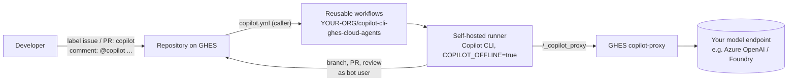

# Copilot CLI agents for GitHub Enterprise Server

Run a **coding agent** and a **review agent** on **GitHub Enterprise Server (GHES)** with
[GitHub Copilot CLI](https://github.com/github/copilot-cli) inside GitHub Actions. All model traffic goes
through the GHES **copilot-proxy** to a model endpoint you control, such as Azure OpenAI / Microsoft Foundry.

- Label an issue `copilot` and a pull request appears.
- Comment `@copilot fix the tests` on that pull request and the agent pushes a follow-up commit.
- Label a pull request `copilot` and you get a review with inline comments.

> [!IMPORTANT]
> This is a **community sample, not a GitHub product**. It is *not* the Copilot cloud agent or
> Copilot code review from github.com. It recreates a similar experience on GHES, using building blocks you
> host yourself. It is not supported by GitHub or Microsoft. The GHES copilot-proxy is a preview feature.
> Try it on a test instance first.

## How it works



| Trigger | Agent | Result |
|---|---|---|
| Issue labeled `copilot` | Coding | Branch `copilot/issue-N` + pull request that closes the issue |
| Issue labeled `copilot:<agent>` | Coding | Same, using custom agent `.github/agents/<agent>.agent.md` |
| PR comment `@copilot <request>` | Coding | Commit pushed to the PR branch |
| PR comment `@copilot agent:<agent> <request>` | Coding | Same, using a custom agent |
| PR labeled `copilot` / `copilot:<agent>` | Review | PR review with summary and inline comments |

Only users with `OWNER`, `MEMBER` or `COLLABORATOR` association can trigger the agent via comments.

### Where it runs, compared with github.com

| | github.com Copilot cloud agent | This sample on GHES |
|---|---|---|
| Compute | GitHub-hosted Actions runner, managed by GitHub | **Your** self-hosted runner |
| Network sandbox | Firewall with an allowlist, managed by GitHub | Whatever you put around the runner |
| Model | GitHub-hosted models | **Your** endpoint via the GHES copilot-proxy |
| Credentials | Scoped, short-lived; not visible to the agent | A bot token in the job environment (see [Security](#security)) |
| UI | Agents tab, session logs, `@copilot` assignment | Labels, comments, Actions run log + job summary |

## What's in the repository

```
.github/workflows/coding-agent.yml   reusable: issue/comment -> code changes -> PR
.github/workflows/review-agent.yml   reusable: PR -> Copilot review
templates/copilot.yml                caller workflow to copy into each repository
templates/copilot-smoke-test.yml     optional: verify the runner can reach the proxy
scripts/setup-runner.sh              install git, gh, jq, Node 22, Copilot CLI on Ubuntu
examples/.github/                    sample copilot-instructions.md and custom agent
docs/setup.md                        step-by-step setup
```

## Quick start

Full details are in **[docs/setup.md](docs/setup.md)**.

1. **GHES admin:** enable the copilot-proxy and point it at your model endpoint.
2. **Runner:** register a Linux self-hosted runner with the label `copilot-agent`, then run `scripts/setup-runner.sh`.
3. **Bot user:** create `copilot-agent`. Store its PAT (`repo`, `workflow`, `read:org`) as the org secret `COPILOT_AGENT_TOKEN`.
4. **Import** this repository into your GHES org, and allow org access to its workflows (Settings → Actions → Access).
5. **Per repository:** copy `templates/copilot.yml` to `.github/workflows/`, replace `YOUR-ORG`, and create a `copilot` label.
6. Open an issue, add the `copilot` label, and watch the Actions tab.

## Custom instructions, agents and skills

The agents run Copilot CLI inside the checked-out repository, so it picks up what you already use locally:

- `.github/copilot-instructions.md`, `AGENTS.md`, `.github/instructions/**/*.instructions.md`
- Custom agents in `.github/agents/<name>.agent.md`, selected with `copilot:<name>` or `@copilot agent:<name>`
- Skills in `.github/skills/`

Each run lists the instruction files it loaded in the **job summary**. See `examples/` for a starter set.

## Security

Guardrails that are built in:

- Issue and comment text is fetched through the API and passed as a prompt. It is never interpolated into shell scripts.
- Copilot CLI is denied `git commit`, `git push` and `gh`. The workflow commits, pushes and opens the PR itself.
- Comment triggers are limited to owners, members and collaborators. The bot's own comments are ignored.
- Each run gets an isolated `COPILOT_HOME` (no shared session state between runs).

**Known limitation:** the bot token is in the job environment, so a prompt-injected agent could still use
it, for example with `curl`. Mitigations:

- Limit the bot's access to the repositories that need it.
- Use ephemeral runners.
- Restrict outbound network from the runner to GHES only.
- Review every PR the agent opens. Branch protection should require human approval.

For stronger isolation (no token in the agent's environment, a network firewall and threat detection), look at
[GitHub Agentic Workflows (gh-aw)](https://github.com/github/gh-aw). It is more complex to run on GHES.

## Troubleshooting

| Symptom | Fix |
|---|---|
| `workflow was not found` / not allowed | Set Actions access on the imported repository to the organization (setup step 4) |
| Job stays queued | No online runner with labels `self-hosted` + `copilot-agent` |
| `unable to verify the first certificate` / `self-signed certificate` | Trust the GHES CA on the runner (`setup-runner.sh --ca-cert`) |
| `Copilot CLI not found on runner` | Run `setup-runner.sh`, or `npm i -g @github/copilot` |
| 401/403 from `_copilot_proxy` | Check `COPILOT_AGENT_TOKEN`, and that the copilot-proxy is enabled |
| Agent finishes "without making changes" | Check the job summary for the prompt and the Copilot output; make the issue more specific |
| Review has no inline comments | The model referred to lines outside the diff; those notes appear under "Additional notes" |

## License

[MIT](LICENSE)
